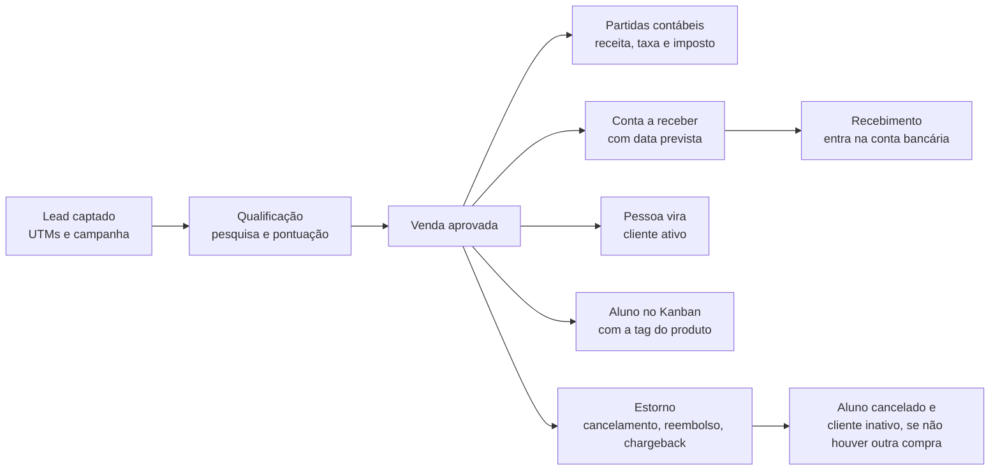

# Modelo de dados

Toda tabela de negócio tem `workspace_id` (o cliente) e é protegida por RLS: cada usuário só enxerga os workspaces dos quais é membro.

## Fluxo de uma venda

## Tabelas por área

### Clientes e acesso
| Tabela | Para que serve |
| --- | --- |
| `workspaces` | Um registro por cliente |
| `workspace_membros` | Quais usuários acessam cada workspace |

### Contabilidade e financeiro
| Tabela | Para que serve |
| --- | --- |
| `plano_contas` | Contas contábeis (ativo, passivo, receita, dedução, despesa) |
| `centros_custo` | Onde o dinheiro é gasto ou ganho (por exemplo, canal ou produto) |
| `contas_bancarias` | Contas reais, cada uma ligada a uma conta contábil |
| `regras_contabilizacao` | Qual conta debita e credita em cada evento |
| `impostos_config` | Alíquotas aplicadas sobre as vendas |
| `lancamentos` e `partidas` | Razão contábil (só leitura para o app, gerado por funções) |
| `movimentacoes_bancarias` | Entradas e saídas das contas bancárias |
| `contas_receber` | O que a plataforma ainda vai repassar, com data prevista |

### Vendas
| Tabela | Para que serve |
| --- | --- |
| `plataformas_venda` | Hotmart, Kiwify, Eduzz etc., com taxa padrão |
| `plataforma_formas_pagamento` | Taxa e prazo de recebimento por Pix, cartão e boleto |
| `produtos` | Produtos, recorrência e taxa diferenciada opcional |
| `produto_plataforma` | Identificador do produto em cada plataforma |
| `vendas` | Cada venda, com taxa, imposto, líquido e previsão calculados |
| `estornos` | Cancelamentos, reembolsos e chargebacks |

### CRM
| Tabela | Para que serve |
| --- | --- |
| `pessoas` | Leads e clientes, com UTMs, campanha, canal e qualificação |
| `pessoa_historico` | Registro das mudanças de status e qualificação |
| `etapas_kanban` | Etapas dos quadros de leads e de alunos |
| `alunos` | Quem comprou o quê, com a tag do produto, para o Kanban de alunos |

### Campanhas
| Tabela | Para que serve |
| --- | --- |
| `campanhas` | Metas gerais: leads, vendas, taxa de conversão, receita e CAC |
| `campanha_canais` | Meta e orçamento por canal, com a `utm_campaign` que o identifica |

## Views para dashboard

| View | O que mostra |
| --- | --- |
| `v_funil_campanha` | Leads, qualificados, vendas e receita contra as metas da campanha |
| `v_dre_mensal` | Resultado por conta e por mês |
| `v_saldo_contas_bancarias` | Saldo atual de cada conta |
| `v_fluxo_caixa` | Entradas e saídas, realizadas e previstas |

## Funções principais

| Função | O que faz |
| --- | --- |
| `provisionar_workspace(nome)` | Cria um cliente novo já com plano de contas, regras e etapas padrão |
| `vincular_usuario(workspace, email)` | Dá acesso de um login a um workspace |
| `registrar_recebimento(conta_receber)` | Dá baixa na conta a receber e movimenta o banco |
| `registrar_recebimentos_ate(workspace, data)` | Recebe de uma vez tudo o que venceu até a data |
| `registrar_estorno(venda, tipo)` | Cancela, reembolsa ou registra chargeback |

## Acrescentado na v0.2.0

Tabelas: `canais`, `funis`, `fornecedores`, `contas_pagar`, `planejamento_mensal`. A campanha ganhou `funil_id`; `vendas.plataforma_id` passou a ser opcional.
Funções: `registrar_pagamento`, `cancelar_conta_pagar` (públicas para quem está logado), `_provisionar_extras` (interna).
Views: `v_marketing_campanha`, `v_marketing_canal`; `v_fluxo_caixa` inclui contas a pagar.

## Adições da jornada, tráfego e contabilidade (v0.3)
Tabelas: `funil_etapas`, `funil_listas`, `pessoa_funil`, `pessoa_lista`, `pessoa_funil_historico`, `anuncios`, `metricas_anuncio_dia`. Colunas novas em `pessoas`: utm_id, gclid, fbclid, referrer. Views: `v_trafego_anuncio_dia`, `v_lancamentos`. Funções: `entrar_na_lista`, `sair_da_lista`, `registrar_lancamento_manual`, `estornar_lancamento`.

## Módulo Growth (v0.3)
`growth_metricas`: árvore de métricas por workspace (pai, papel, fonte manual ou automática, chave automática, unidade, direção, meta, valores manuais). No máximo uma North Star por workspace e sem ciclos na árvore. `growth_experimentos`: ideia, hipótese, métrica alvo, ICE (impacto, confiança e facilidade de 1 a 10, score = média), etapa (ideia, priorizado, rodando, analise, concluido), resultado, decisão e aprendizado. Concluir exige resultado e aprendizado, garantido por constraint no banco.

## Projetos, equipe e links (v0.4)
`equipe` (função, e-mail, WhatsApp, canais de aviso), `projeto_modelos` e `projeto_modelo_atividades` (modelo com subatividades, função, prazo em dias e `depende_de`), `projetos` (um por campanha, único em `campanha_id`), `projeto_atividades` (status bloqueada, liberada, em_andamento, concluida, cancelada), `notificacoes` (uma linha por pessoa e canal) e `campanha_links` (UTM por criativo; cria ou liga o registro em `anuncios` pelo `utm_content`).

## RevOps (v0.5)
`produtos.nivel_escada` (1 = entrada), `alunos.saiu_em` (mantido por gatilho a partir do status), `heavyops_metas` (metas por workspace) e a função `heavyops_painel(ws, dias)`, que devolve todos os números do dashboard em um JSON.

## Planejamento de conteúdo (v0.6)
`conteudo_linhas` e `conteudo_temas` (prioridade 1 a 3, cor), `conteudo_config` (nomes dos 5 critérios de nota), `conteudo_metas_semanais` (meta por formato), `conteudos` (etapa, formato, canais, links de copy, mídia e fonte, 5 notas de ideia e 5 de pauta, `ideia_media` e `pauta_media` geradas), `conteudo_publicacoes` (um registro por conteúdo e canal, com as métricas) e `conteudo_conta_dia` (métricas diárias da conta por canal). A função `conteudo_importar_ideias(ws, itens, origem)` cria ideias em lote e ignora título repetido. Um gatilho aplica as regras do Kanban. Todas as tabelas têm RLS por workspace.

## Análise de funil e pesquisas (v0.7)
Funções (sem tabelas novas): `funil_analise`, `funil_cohorts`, `funil_pessoas`, `funil_membros`, `funil_ads`, `funil_resolve`. Pesquisas: `pesquisas` (tipo, gatilho, etapa, opção de dispensar qualificados, link aberto), `pesquisa_perguntas` (tipo e papel), `pesquisa_envios` (fila, token único, situação), `pesquisa_respostas` e `pesquisa_resposta_itens`, `pesquisa_insights`. Gatilhos em `pessoas`, `pessoa_funil_historico` e `alunos` enfileiram os envios. `pesquisa_publica` e `pesquisa_responder` são as duas únicas funções liberadas ao público, sempre com token. `growth_experimentos` ganhou `pesquisa_id` e `insight`. `integracoes` aceita as categorias `social` e `ia`.

## v0.8: pós-compra no funil
- `aluno_historico` (workspace_id, aluno_id, pessoa_id, tipo etapa|saida|volta, etapa_kanban_id, em): preenchida por gatilho em `alunos`. Os alunos que já existiam receberam um registro da etapa atual.
- `funil_membros`: novas chaves `alunos`, `a:<etapa do aluno>`, `ativos`, `saiu`, `ascensao`, `recompra`.
- `funil_analise`: novo campo `pos` (resumo) e, por campanha, `roi`, `ltv`, `alunos`, `churn`.
- `funil_cohorts(p_gran: semana|mes|campanha)`: custo, cpl, cac, ltv, roas, roi, ltv_cac, alunos, ativos, saiu, churn, retencao, ascensao, recompra, rN_ok/rN_base.

## v0.10
- `campanha_fechamentos` (campanha_id, fechado_em, fechado_por, periodo_ini/fim, snapshot jsonb) e `campanha_melhorias` (titulo, descricao, origem manual|regra, sprint, status a_fazer|em_andamento|feito|descartado, prazo, responsavel). RLS por workspace.

## v0.11 — contratos
- `contratos` (pessoa, status rascunho|ativo|encerrado|cancelado, datas, recorrente/periodicidade, num_parcelas, conta_bancaria_id, forma_pagamento, acessos) e `contrato_itens` (produto, quantidade, valor).
- `contas_receber` ganha `contrato_id`, `parcela`, `descricao`; `venda_id` passou a ser opcional (uma das duas origens é obrigatória).
- Funções `ativar_contrato`, `cancelar_contrato`; `registrar_recebimento` trata parcela de contrato. Contas novas: 1.1.03 Contas a receber – contratos e 4.1.02 Receita de serviços; regras `contrato_receita` e `contrato_recebimento`.
- View `v_contratos_pendentes` (cliente sem venda aprovada e sem contrato).

## v0.19
- `projetos.pessoa_id`, `contrato_id`, `venda_id`, `produto_id`; `produtos.modelo_projeto_id`. Funções `projeto_do_produto`, gatilhos `contratos_projetos_t` (contrato ativo) e `vendas_projeto_t` (venda aprovada), com índices únicos para não duplicar.
- `canais`: whatsapp_api, linkedin_ads, tiktok_ads, gpt_ads, criados para todos os workspaces e para os novos.

## v0.16
- `plano_contas.cac_grupo` (midia|equipe|ferramentas|comissao|outros): define o que entra no CAC. Preenchido por padrão para 6.1.x (mídia) e 6.2.03 (comissões).
- `pessoa_notas` (workspace, pessoa, texto, autor, data), RLS por workspace.

## v0.14
- `planos.mercado_total` e `planos.mercado_rotulo` (penetração de mercado).

## v0.13
- `importacoes` (workspace, tipo trafego|video_metricas|video_presenca, motivo, justificativa, arquivo_nome, hash único entre aplicadas, linhas, período, status aplicada|revertida, quem). Colunas `origem` (integracao|importacao|legado) e `importacao_id` em `metricas_anuncio_dia`, `video_metricas_dia` e `presencas_video`.
- RPCs `importar_trafego`, `importar_video_metricas`, `importar_video_presenca` (parâmetro `p_simular`) e `reverter_importacao`. INSERT/UPDATE/DELETE direto nessas tabelas revogado para usuários.

## v0.12
- `motivos_resultado` (tipo ganho|perdido) e, em `pessoas`: `tags text[]`, `negocio_status` (aberto|ganho|perdido), `negocio_motivo_id`, `negocio_obs`, `negocio_fechado_em`. Virar cliente sem fechamento manual marca ganho; mudanças entram em `pessoa_historico` (campo "negocio").
- `planos`, `plano_objetivos`, `plano_indicadores`, `plano_metas` (RLS por workspace) e `campanhas.meta_id`. Função `valor_indicador(ws, chave, ini, fim)` calcula o realizado (DRE, contratos, leads, clientes, tráfego).

## v0.20 — Etapas, responsáveis e alertas
- `etapas_kanban`: `descricao`, `mensagem_padrao`, `alertar_responsavel`.
- `pessoas.responsavel_comercial_id` e `alunos.responsavel_cs_id` (FK `equipe`, validados pelo workspace por trigger).
- `notificacoes.pessoa_id`; `projeto_id` e `atividade_id` agora opcionais.
- `equipe_avisa(ws, equipe, pessoa, titulo, msg)`; triggers `pessoas_alerta_t` e `alunos_alerta_t` (ao atribuir responsável e ao entrar em etapa com alerta).

## v0.21 — Função `revops_cohorts`
`revops_cohorts(p_ws, p_ini, p_fim, p_gran 'mes'|'semana', p_agrupar 'periodo'|'campanha'|'produto'|'canal'|'utm_source'|'tag', p_metrica 'retencao'|'recompra'|'receita', p_campanha, p_produto, p_canal, p_utm_source, p_tag, p_max)` devolve linhas por coorte (`grupo`, `rotulo`, `tamanho`, `pontos[k, el, abs, valor]`), o total ponderado e as opções de filtro. Só lê (STABLE), respeita o workspace e não usa IA.

## v0.22 — Empresa, funções e permissões
- `empresa` (1 por workspace): nome, razao_social, cnpj (somente dígitos, validado por `cnpj_valido`), telefone, email_contato, endereco, responsavel_*, financeiro_*, regime_tributario, regime_apuracao, exercicio_inicio/fim, periodicidade_fechamento, observacoes. Leitura: membros; escrita: administradores.
- `funcoes` (por workspace): nome, descricao, administrador, permissoes (jsonb módulo → nenhum|ler|editar). Módulos: adm, mkt, vendas, revops, fin, prj, gro, cfg, cad.
- `workspace_membros.funcao_id`, `equipe.funcao_id`, `equipe.acesso_ativo`, `equipe.user_id`.
- Funções: `eh_admin(ws)`, `nivel_modulo(ws, módulo)`, `perm(ws, 'ler'|'editar', módulos[])`, `minhas_permissoes(ws)`, `acessos_do_workspace(ws)` (admin), `papel_da_funcao`. Trigger `equipe_guarda_t` impede quem não é admin de mexer em acesso.
- Políticas restritivas `perm_ler`, `perm_inserir`, `perm_alterar`, `perm_excluir` em cada tabela de negócio (mapa tabela → módulos que leem/editam na migração `20261006370000`). Tabelas de apoio (campanhas, produtos, canais, etapas, equipe, motivos) são legíveis por qualquer membro; só a escrita é restrita.
- Pendente de aplicar (arquivo `20261006380000`): `sincroniza_acesso(equipe_id)`, `aceitar_convites()` e trigger `equipe_sincroniza_t`.

## v0.23 — Responsáveis e ascensão
- `responsavel_historico` (workspace_id, tipo comercial|cs, pessoa_id, aluno_id, de/para equipe e nome, alterado_por, alterado_por_email, motivo, alterado_em). Preenchida só por trigger; leitura restrita aos módulos vendas, revops, adm, prj, fin.
- `vendas.vendedor_id` e `contratos.vendedor_id` → equipe; preenchidos na criação com `pessoas.responsavel_comercial_id` se vierem vazios.
- Triggers: `pessoas_resp_hist_t`, `alunos_resp_hist_t` (histórico), `alunos_herda_cs_t` (CS herdado), `vendas_vendedor_t`, `contratos_vendedor_t`.
- Função `revops_ascensao(p_ws, p_ini, p_fim, p_entrada, p_min_dias)` → jsonb (pessoas, produtos, bases, transicoes, paradas, caminhos).

## v0.24 — Rateio e permissões por ação
- `rateio_regras` (nome, ativo) e `rateio_itens` (regra, centro_custo, percentual 0–100). `contas_pagar.rateio_regra_id` e `plano_contas.rateio_regra_id` (regra da conta a pagar vence a da conta contábil).
- `centros_custo.entra_no_cac` (padrão true).
- `v_custos_rateados`: uma linha por conta a pagar × centro, com `valor = valor_total × percentual / 100`; só usa regras ativas que somam 100%. Sem regra: 100% no centro da conta (ou sem centro, entra inteira).
- `v_rateio_regras`: soma dos percentuais por regra.
- `funcoes.acoes` (jsonb recurso → ação → bool), `equipe.permissoes_ind` (módulo → nível) e `equipe.acoes_ind`. Recursos: clientes, vendas, contratos, alunos, contas_receber, contas_pagar, campanhas, produtos, projetos. Ações: ver, criar_lead, criar, editar, excluir.
- Funções: `pode(ws, recurso, acao, módulos)`, `valida_acoes`, `nivel_modulo` (agora lê a permissão individual), `minhas_permissoes` (devolve também `acoes`).

## Função receber_periodo (v0.26)
`receber_periodo(p_ws, p_ini, p_fim, p_hoje)` → jsonb: `a_receber{valor,qtd,de_contratos}`, `atraso{valor,qtd}`, `recebido{valor,qtd}`, `mrr`, `arr`, `por_mes[{mes,valor,qtd}]`, `por_cliente[{id,nome,a_receber,de_contratos,atraso,recebido,mrr,arr,contratos}]`. Cliente = pessoa do contrato ou da venda.

## v0.28
`pessoas.captada boolean default true`; `alunos.contrato_id`, `alunos.origem` ('venda','contrato','historico'), `alunos.venda_id` nulo permitido; tabela `pagamentos_historicos(workspace_id, pessoa_id, produto_id, valor, periodo_inicio, periodo_fim, descricao)` com RLS por módulo; função `cadastrar_cliente_historico(p_ws, p_nome, p_email, p_telefone, p_data_entrada, p_produto, p_valor_pago, p_situacao, p_canal, p_cs)`.

## v0.29 — modo financeiro e custos do CAC
- `workspaces.modo_financeiro text not null default 'completo'` (check: 'completo' | 'simplificado').
- `custos_cac(id, workspace_id, descricao, valor>0, competencia, grupo, rateio_regra_id, fornecedor_id, campanha_id, campanha_canal_id, criado_em, criado_por)`; grupo: midia, comissao, equipe, ferramentas, outros. RLS: ler fin/adm/mkt, editar fin/mkt.
- `v_custos_rateados` = contas a pagar rateadas **mais** `custos_cac` (tratado como pago na competência; sem regra entra inteiro). `v_marketing_campanha` e `v_marketing_canal` somam `custos_cac` no investimento; `growth_metricas_auto` e `campanha_series` também.
- Migração do bloqueio (a rodar): `fin_completo(ws)`, política restritiva `fin_modo` em contas_bancarias, movimentacoes_bancarias, contas_pagar, lancamentos e partidas, `definir_modo_financeiro(p_ws, p_modo)` (admin) e ajuste de `registrar_recebimento` (sem banco usa a conta "Recebimentos (controle interno)").

## v0.30 — uso da plataforma
`uso_eventos(id, workspace_id, user_id default auth.uid(), usuario_email, sessao, tipo, tela, detalhe, segundos, criado_em)`; tipo: tela, tempo, modal_abre, modal_salva, modal_cancela, erro. RLS: inserir só como si mesmo e no próprio workspace; ler só `eh_admin`. `uso_resumo(p_ws,p_ini,p_fim)` (security definer, só administrador, máximo 400 dias) devolve por_tela, por_usuario, por_dia, formularios, erros_top.

## v0.32 — formas de pagamento, fornecedor e provisão
- `formas_pagamento(id, workspace_id, nome único, tipo [pix|boleto|cartao|debito_automatico|transferencia|dinheiro|outro], titular_terceiro, conta_bancaria_id, ativo)`. Permissões: ler fin/adm/cad, editar fin/cad.
- `fornecedores`: `tipo_custo` (fixo|variavel), `valor_padrao`, `dia_vencimento` (1–31), `conta_despesa_id`, `centro_custo_id`, `forma_pagamento_id`, `provisionar`.
- `contas_pagar`: `forma_pagamento_id`, `estimativa`, `provisionada`, `substituida_por`. Índice único (workspace, fornecedor, competência) onde `provisionada`. Gatilho `contas_pagar_estimativa_t` impede pagar conta estimada.
- Funções: `provisionar_contas_pagar(p_ws, p_meses=2, p_hoje)` e `confirmar_valor_conta_pagar(p_conta, p_valor, p_vencimento)`. Contas novas: 6.2.04 e 6.3.xx (ver CHANGELOG).
- A tabela `formas_pagamento` é diferente de `plataforma_formas_pagamento` (taxas e prazos de plataforma de venda).

## contrato_parcelas_plano (v0.39)
Plano de parcelas de um contrato: contrato_id, numero, valor, vencimento (único por contrato e número). Mesmas permissões dos itens do contrato (vendas).

## oportunidades (v0.42)
workspace_id, pessoa_id (cliente), titulo, tipo (nova_venda/renovacao/ajuste), produto_id, contrato_origem_id, valor_estimado, previsao_fechamento, etapa_kanban_id (quadro 'oportunidades' em etapas_kanban), status (aberta/ganha/perdida), motivo, responsavel_id (equipe), observacoes, criado_em, fechado_em. Permissões do módulo vendas.

## contas_receber.substituida_por (v0.44)
Aponta para a parcela nova quando uma parcela cancelada de contrato é reativada. Parcela com substituida_por não aparece na lista.

## plano_contas.conta_passivo_id (v0.47)
Referência a outra conta do plano (passivo). Em conta de despesa/custo indica onde registrar o que ainda falta pagar; vazio usa 2.1.01 Fornecedores a pagar. Novas contas: 2.1.03 Pró-labore e retiradas a pagar; 3.1.02 Distribuição de lucros.

## gm_alavancas (v0.49) e Growth Model automático
`gm_alavancas` (workspace, loop_chave, produto_id opcional, alavanca, mês, cenario base|sim, valor): ajustes digitados nas alavancas do Growth Model. Chaves de alavanca: `vol` (volume da primeira etapa do loop), `r:<etapa>><etapa>` (taxa entre etapas, ou CPM para investimento > impressões) e `tkt` (ticket). Único por workspace, loop, produto, alavanca, mês e cenário. RLS: acesso ao workspace + permissões do módulo Growth.
Função `growth_modelo_historico(ws, ini, fim)`: devolve por mês e por loop investimento, impressões, cliques, visitas, leads, qualificados, compras, receita e base de elegíveis, lidos de campanhas, `v_trafego_anuncio_dia`, pessoas, vendas, contas a pagar e custos de CAC, contratos e contas a receber. As tabelas `gm_funis`, `gm_etapas`, `gm_valores` e `gm_config` (v0.48) ficaram sem uso.

## importar_plano_contas (v0.51)
`importar_plano_contas(p_ws, p_contas jsonb, p_modo text)`: só administrador. Valida códigos, nomes, tipos e duplicados; em `substituir` solta as referências (regras, fornecedores, conta_passivo_id, conta_pai_id) e apaga o plano; insere por nível. Devolve inseridas, atualizadas e removidas.

## regras_contabilizacao: nome e personalizada (v0.53)
`nome text` e `personalizada boolean`. A restrição do evento: evento do sistema (lista dos 9) quando `personalizada = false`; quando `true`, código `^x_[a-z0-9_]{2,40}$` e `nome` preenchido. Continua único por (workspace, evento).

## workspaces.modo_produto (v0.55)
`modo_produto text` ('completo' padrão ou 'starter'). Função `criar_workspace_starter(p_nome)` provisiona o workspace (plano de contas, regras, etc.) e marca como starter.

## workspaces.agencia (v0.57)
`agencia boolean` (padrão false). Marca o workspace da agência (Mathisa). `sou_equipe_interna()` é verdadeira se o usuário é membro de um workspace com agencia = true. `criar_workspace_cliente(p_nome, p_modo)` só roda para a equipe interna.

## dashboard_layouts (v0.58)
Chave (user_id, workspace_id); `layout jsonb` com `k` (indicadores em ordem) e `b` (blocos em ordem); o que não está na lista fica oculto. RLS: cada pessoa lê e grava só o seu.

## Dashboard de mídia (v0.59)
Lê `v_trafego_anuncio_dia` (por anúncio e dia: impressões, cliques, custo, leads, vendas, receita, alcance, canal, campanha e ângulo). Nada novo no banco.

## ia_perguntas e ia_contexto (v0.60)
`ia_perguntas`: histórico de perguntas (pergunta, resposta, provedor, modelo, sem_dado, nao_conferidos), RLS por pessoa. `ia_contexto(p_ws, p_ini, p_fim)` devolve jsonb com: resumo_mensal, midia_por_canal, midia_por_campanha, midia_por_angulo, receita_por_produto, resultado_contabil_mensal e contas_a_pagar_em_aberto. Roda com os direitos de quem chama (RLS vale) e não traz dados pessoais.

## v0.62
Sem mudança no modelo de dados.

## v0.63
- `campos_personalizados(id, workspace_id, entidade, chave, rotulo, tipo text|number|date, criado_em)`, única por (workspace, entidade, chave); chave `^[a-z][a-z0-9_]{1,40}$`; RLS por workspace.
- `extras jsonb not null default '{}'` (precisa ser objeto) em pessoas, produtos, fornecedores, campanhas e vendas: valores dos campos personalizados, por chave.
- `dashboard_layouts` ficou sem uso.

## v0.65
- `ofertas(produto_id, nome, papel principal|upsell|order_bump|cross_sell|downsell, preco, ativo)`.
- `campanha_ofertas(campanha_id, produto_id, oferta_id?, nome, papel, preco, ordem)`: preço e papel que valem só na campanha.
- `campanha_calculos(campanha_id?, nome, premissas jsonb)`: cenários da calculadora (campanha_id vazio = simulação avulsa).
- `campanhas.meta_cpl` e `campanha_canais.meta_cpl`.
- `campanha_ofertas_resultado(p_ws, p_campanha)`: por oferta, vendas e receita (vendas aprovadas e contratos ativos/encerrados da campanha, por produto).

- `benchmarks_mercado(workspace_id, metrica cpl|cac|conv|ticket|roas|margem|leads|receita, valor, fonte, atualizado_em)`: referência de mercado digitada pelo usuário; única por workspace e métrica.

- `fornecedores`: acrescentadas `endereco`, `observacoes`, `contrato_url` (link, sem upload de arquivo).

- `contas_receber`: acrescentadas `desconto`, `desconto_motivo`, `desconto_em`. `plano_contas`: conta padrão 5.1.03 Descontos concedidos (dedução). `lancamentos.origem_tipo` aceita `desconto`.

## gm_modelos.dados (v0.76)
Novo campo `cen`: `{ loopId: { chaveDaTaxa: valor } }` com as taxas de cenário dos loops do sistema. Em modelos importados, cada passo pode ter `b` (baseline) e `c` (cenário).

## v0.77 — Estratégias e jornada
- `funis`: tipos novos (webinario, disparo, recompra, comercial) e `modelo_pronto`. Na tela, chama-se Estratégia.
- `funil_etapas`: não muda. São as colunas do Kanban da jornada.
- `etapas_catalogo` (workspace, chave única, nome, unidade numero|brl|pct, origem, métrica).
- `estrategia_etapas` (funil_id, ordem, fase aquisicao|aquecimento|conversao|retencao, chave, nome, unidade, origem anuncios|leads|etapa_funil|lista|video|vendas|disparo|manual, metrica, origem_ref, conta_como investimento|clientes_novos|upgrades|renovados|receita, taxa_esperada fração). Única por (funil_id, chave).
- `campanha_etapas`: os mesmos campos, mais `ativa`. É a cópia por campanha, única por (campanha_id, chave).
- `campanhas.fases` jsonb: `{fase: {ini, fim}}`.
- `campanha_etapa_valores` (campanha_etapa_id, data, valor, origem manual|sendflow|importacao). Única por (etapa, data).
- `vendas`: `canal_fechamento`, `utm_source`, `utm_medium`, `utm_campaign`, `utm_content` (último clique).
- `pessoa_toques` (pessoa_id, em, tipo entrada|etapa|lista|video|disparo|comercial|compra|recompra|outro, canal, campanha_id, chave, descricao, UTMs, origem sistema|sendflow|manual|importacao, ref_tabela, ref_id). Única por (pessoa_id, ref_tabela, ref_id, tipo).
- Funções: `campanha_aplicar_estrategia(campanha, funil, substituir)` e `campanha_funil_etapas(campanha, de, até)`. Gatilhos `toque_trg_*` em pessoas, pessoa_funil_historico, pessoa_lista, presencas_video, responsavel_historico, vendas e contratos.

## v0.78
Sem mudança de banco. `gm_modelos.dados.cen[loopId]` agora também guarda `inv` (ou a chave do primeiro passo), `r_cpm`, `r_cpl` e `r_cac`.

## v0.79
Sem mudança de banco.

## v0.80
Nova função `pode_editar(ws, módulos[])`: sessão de serviço, ou membro com nível editar em algum dos módulos. Substitui `pode_operar` nas 32 RPCs de escrita (`pode_operar` continua existindo, sem uso). EXECUTE revogado de `anon` e `public` em todas as funções (só `pesquisa_publica` e `pesquisa_responder` ficam para `anon`); padrão de funções novas fechado. Gatilho `contas_pagar_estimativa_t` (função `contas_pagar_bloqueia_estimativa`). `provisionar_workspace` deixa de aparecer como chamável pelo front.

## v0.81
- `estrategia_blocos` (workspace_id, funil_id, ordem, fase, tipo, nome, origem_ref) e `campanha_blocos` (o mesmo com campanha_id, bloco_origem_id e ativo). RLS como as etapas: ler mkt/vendas/gro/adm, editar mkt/gro.
- `estrategia_etapas` e `campanha_etapas` ganham `bloco_id` (FK com cascata), `papel` (principal ou diagnostico) e `fonte` (texto: de onde vem o número). Gatilho `bloco_etapa_valida` garante bloco da mesma estratégia/campanha e workspace.
- `campanha_aplicar_estrategia` copia os blocos (só os que vão receber etapa nova) e liga as etapas; `campanha_funil_etapas` devolve bloco_id, papel e fonte.
- `simulador_cenarios` (nome, dados jsonb com todas as premissas, versao_formula, status) e `simulador_snapshots` (cenario_id, nome, versao_formula, premissas, metricas, calculado_em; sem UPDATE). RLS: ler gro/fin/adm, editar gro. Gatilho `simulador_mesmo_ws`.
- Formato de `simulador_cenarios.dados`: inicio (AAAA-MM), horizonte, margemAlvo (%), regime, modoCusto, impostoPct, rateio, produtos[] (preco, cobranca, parcelas, reembolsoPct, churnPct, duracaoMax, simples{base,pct,unit,impostosInclusos}, completo[{cat,base,valor}], produtoRef, rateioPct, ativo), fixos[], canais[] (midia, outros, modo, leads, conversaoPct, clientes, entrada, meses), jornada[] (de, para, probPct, lag, maxCompras), cenarios{conservador, otimista, custom}.

## v0.82
Sem mudança de banco.

## v0.83
`contas_pagar.saldo_de` (uuid, FK para contas_pagar): o saldo aponta para a conta que gerou a baixa parcial. Preenchida por `registrar_pagamento_parcial`; contas antigas preenchidas pela migração (mesma descrição + " (saldo)", mesmo fornecedor e competência, criada junto com o lançamento "Divisão por pagamento parcial"; 6 saldos ligados em produção).

## v0.85
- `acesso_telas` (tela, modulo, nome, grupo, ordem): catálogo das telas do menu (56), leitura para todos, escrita só por migração.
- `pacotes_acesso` (nome único, descricao, telas text[], ativo): leitura só da equipe interna.
- `workspaces.pacote_id`, `acesso_liga text[]`, `acesso_desliga text[]`.
- Funções: `acesso_telas_ws(ws)` (null = sem restrição), `modulo_liberado(ws, modulo)`, `acesso_workspace(ws)` (para a tela), `pacote_salvar`, `pacote_excluir`, `clientes_acesso`, `workspace_definir_acesso` (todas com checagem de equipe interna). `nivel_modulo` passa a devolver 'nenhum' para módulo fora do pacote.

## v0.86
- `contas_bancarias.tipo` ('conta' | 'cartao', padrão 'conta'), `dia_vencimento` (1–31). Gatilho `contas_bancarias_cartao_padrao_t`: cartão nunca é padrão.
- `v_saldo_contas_bancarias` passa a ter só `tipo = 'conta'` (os painéis leem dela). Nova `v_cartoes_fatura` (conta_bancaria_id, nome, banco, dia_vencimento, ativa, fatura_aberta, compras, pagamentos), security_invoker.
- `lancamentos.origem_tipo` aceita 'fatura_cartao'. Funções `pagar_fatura_cartao(cartao, valor, data, banco)` e `desfazer_fatura_cartao(lancamento, data)`, ambas com `pode_editar(fin)`.
- `contas_receber.conta_receita_id` (avulsa). `receber_avulso_criar(ws, descricao, valor, vencimento, conta_receita, conta_bancaria)`, `receber_avulso_cancelar(id)`. `registrar_recebimento` passa a creditar a conta de receita da avulsa e recusa receber em cartão; `registrar_recebimento_parcial` recusa avulsa.
- `painel_gerencial`: "entrou/saiu/qtd_realizado" ignoram movimentos de cartão.
- `projeto_atividades.campanha_bloco_id`. `_bloco_tarefas(tipo, nome)` (subatividades por tipo de bloco), `_campanha_gerar_atividades(campanha)`, `campanha_gerar_atividades(campanha)` (RPC, pode_editar prj/mkt) e gatilho `campanha_blocos_atividades_t` (after insert em campanha_blocos).
- Pacote de acesso "Casa" e `workspaces.pacote_id` do workspace "Casa".

## v0.87
- `workspaces.casa_de` (uuid → workspaces; único; a Casa não pode ser agência nem dela mesma). `clientes_acesso` ignora workspaces com `casa_de`.
- `transferencias_casa` (ws_origem, ws_casa, data, valor, descricao, conta_pagar_id, lancamento_origem, conta_receber_casa, desfeita_em, criado_por): leitura para quem é membro dos dois; escrita só pelas funções.
- `lancamentos.origem_tipo` aceita 'transferencia_casa'.
- `transferir_para_casa(ws, banco_origem, valor, data, descricao, conta_pagar, conta_contabil_origem, banco_casa, receita_casa)` e `desfazer_transferencia_casa(id, data)`; exigem editar o financeiro dos dois workspaces.

## v0.88
- Funções `norm_fone`, `norm_email`, `norm_nome` (imutáveis). `pessoas.telefone_norm`, `pessoas.email_norm` (geradas); índice único `pessoas_telefone_uq`. `pessoa_resolver(ws, nome, email, telefone, dados)`, view `v_pessoas_duplicadas`, `pessoas_mesclar(manter, remover, motivo)`, tabela `pessoas_mesclagens`.
- `vendas`: índice único `vendas_externo_uq` (workspace, plataforma, id_externo); colunas `comprador_email`, `comprador_telefone`, `aprovada_em`, `reembolsada_em`, `cancelada_em`, `origem_dado` (manual | importacao | integracao); gatilho `vendas_evidencia_t`.
- `auditoria` (workspace_id, tabela, registro_id, acao inclusao|alteracao|exclusao, campos, antes, depois, usuario_id, usuario_email, origem app|servico|banco, em) + gatilho `auditoria_t` (função `auditar`) em 22 tabelas; leitura só de administradores.
- `disponibilidade` e `atualizado_na_origem` em `metricas_anuncio_dia`, `video_metricas_dia`, `campanha_etapa_valores`, `conteudo_conta_dia`.
- `qualidade_regras` (workspace_id, codigo, ativa, tolerancia), `qualidade_catalogo()`, `qualidade_dados(ws, ini, fim)`.
- `metricas_definicoes` (codigo, nome, formula, fonte, sem_dado, observacao, versao).
- `campanha_fechamentos`: `versao`, `status` (oficial | substituido), `motivo`, `substitui_id`, `corte_em`, `qualidade`, `fase`; gatilho de imutabilidade; `campanha_fechar(campanha, ini, fim, snapshot, motivo, fase)`.
- `extrato_conta(conta, ini, fim)`. Telas novas no catálogo de acesso: cfg-qualidade, cfg-metricas, cad-auditoria, cad-duplicados (incluídas nos pacotes existentes).

## v0.89
- `campanha_participacoes` (campanha_id + pessoa_id únicos, entrou_em, era_aluno, era_cliente, canal, campanha_canal_id, temperatura, UTMs, tentativas, ultima_tentativa_em); gatilhos `participacao_t` (pessoa_toques) e `participacao_pessoa_t` (pessoas.campanha_id). `pessoa_toques` aceita tipo 'captura' e origens 'captura' e 'integracao'.
- `registrar_captura(ws, campanha, nome, email, telefone, dados)`, `campanha_captacao(campanha)`. `pessoa_resolver` junta sozinho pelo telefone (`_pessoas_mesclar`, interna). `_canal_de(ws, canal, utm_source)`.
- `campanha_canais.temperatura`, `anuncios.temperatura` (frio | quente).
- `vendas.pedido_ref`; `campanha_ofertas_resultado` devolve `aceite` e `base_aceite`.
- `checkout_abandonos` (+ gatilho `abandono_recupera_t` em vendas), `abandono_registrar`, `abandonos_resumo`.
- `workspaces.atribuicao_padrao` (padrão ultimo_toque); `venda_atribuicoes` (venda + modelo únicos, canal, campanha, temperatura, UTMs, toque_id, peso, regra_versao, evidencia); `atribuir_venda` + gatilho `atribuicao_t`; `vendas_por_canal(ws, ini, fim, modelo, campanha)`.
- `campanha_metas` (tipo, valor, fase, canal, temperatura, segmento, data_ini, data_fim, observacao) + `campanha_metas_painel(campanha)`.
- Tela nova no catálogo de acesso: crm-abandonos.

## v0.90
- `projetos.tags`, `projeto_atividades.tags` (text[], índice GIN).
- `projeto_painel(projeto)`: total, status, responsáveis (abertas, bloqueadas, concluídas, atrasadas), série diária (semanal acima de 90 dias) de planejado e concluído, sem_prazo.
- `projeto_salvar_como_modelo(projeto, nome, padrao_campanha)`, `projeto_vincular_campanha(projeto, campanha)`, `campanha_criar_projeto(campanha, modelo, nome)`.
- `campanha_canais_resultado(campanha)`: por canal da campanha, leads (participações), investimento, CPL, meta de leads, meta de CPL e % da meta de leads. Usa `campanhas.meta_cpl` e `campanha_canais.meta_cpl` (colunas que já existiam).
- Tela nova no catálogo de acesso: prj-atividades.

## v0.91
- `campanhas.projeto_auto` (boolean, padrão verdadeiro) e `campanhas.projeto_modelo_id` (modelo escolhido; vazio = modelo padrão de campanha). `campanha_cria_projeto` não cria projeto quando `projeto_auto` é falso.

## v0.92
Sem mudança no modelo de dados. `supabase/RODAR_TUDO_v0.80_a_v0.91.sql` junta as migrações v0.80 a v0.91 sem alterar nenhuma.

## v0.93
Sem tabela nova. A tela usa `despesas_recorrentes`, `contas_pagar`, `contas_receber`, `plano_contas`, `centros_custo`, `fornecedores` e `empresa.regime_tributario`. As preferências da tela (itens desmarcados, regime simulado, % de custo variável e margem) ficam no navegador (`localStorage` "custoOp:<workspace>"). `acesso_telas` ganhou a tela `fin-custo`.

## v0.94
- `plano_indicadores.chave` aceita `margem_lucro` e `margem_contribuicao`; `valor_indicador` calcula as duas em % pela DRE (`v_dre_mensal`).
- `produtos.extras.mc_custo_pct` (custo do produto em % da receita) e `produtos.extras.mc_custo_cliente` (R$ por cliente no mês).

## v0.95
`plano_indicadores.faixa_ruim` e `plano_indicadores.faixa_otimo` (numeric, opcionais). `valor_meta` é o cenário bom.

## v0.96
Sem tabela nova. `simulador_cenarios.dados.retirada` = { socios: [{nome, valor, hoje}], mes, regime, varPct, aliq, ajuste, margens: {min, boa, otima}, produto }.

## v0.97
- `ofertas`: + descricao, condicoes, parcelas_max, vigencia_ini, vigencia_fim, status (rascunho/ativa/pausada/encerrada), versao; `produto_id` opcional (produto principal).
- `oferta_itens` (oferta × produto, quantidade, alocacao_pct; soma 100% no pacote) e `oferta_versoes` (foto imutável por versão, com itens em jsonb). RPC `oferta_salvar(ws, id, dados, itens)`.
- `campanha_ofertas` (esteira): + oferta_versao, pai_id (etapa anterior), condicao (sempre/aceitou/recusou), etapa_exibicao, elegibilidade, gatilho, taxa_exposicao, taxa_aceite. Gatilho `campanha_ofertas_valida`.
- `campanha_ofertas_resultado` devolve também pai_id, condição, premissas e `base_aceite` = quem recebeu a oferta.
- `campanhas.tipo_midia` (hibrida/paga/organica); `canais.tipo` (pago/organico); `campanha_canais` + tipo, funil_id (estratégia da execução), custo_producao, observacoes; `campanha_estrategias` (campanha × estratégia, principal).
- `growth_metricas` + nsm_evento, nsm_populacao, nsm_frequencia, nsm_fonte, produto_id.

## v0.98
- `gm_cenarios`: nome, hipotese, autor, escopo (jsonb: prod, camp, fase, tipo, de, n), status (rascunho/aprovado/arquivado), versao, substitui_id, baseline e resultados (jsonb, foto do contexto), financeiro (regime, aliq, varPct, ajuste), ue (dados do Unit Economics), impacto/confianca/facilidade/ice_justificativa, aprovado_em/aprovado_por. Gatilho `gm_cenarios_guarda` (aprovado congelado).
- `gm_alavancas.cenario` = 'base' (premissas do baseline) ou o id do cenário; gatilho `gm_alavancas_guarda` (baseline só via `gm_premissas_salvar(ws, linhas, remover, motivo)`, administrador; cenário só em rascunho).
- `simulador_snapshots.cenario_id` passa a apontar para `gm_cenarios`. Auditoria em `gm_alavancas` e `gm_cenarios`.

## v0.99
- `gm_decisoes` (documento de decisão imutável): cenario_id, versao, titulo, documento (jsonb), responsavel, proximos_passos, aprovado_por(_email). RPC `gm_aprovar(cenario, responsavel, proximos, documento)`.
- `growth_experimentos`: etapa aceita ideia, avaliacao, priorizado, preparacao, rodando, analise, concluido, arquivado; + cenario_id (único), decisao_id, tipo (experimento/planejamento), projeto_id, publico, intervencao, instrumentacao, custo_previsto, metrica_alvo, ice_justificativa. RPCs `gm_ideia_do_cenario(cenario)` e `exp_para_planejamento(experimento)`.

## v0.100
- `guardrail_definicoes` (nome, metrica, operador min/max, limite, severidade, escopo, produto_id, janela_dias, frequencia, acao_sugerida, descricao, continuo, ativo).
- `exp_guardrails` (teste × guardrail); gatilho `exp_liga_guardrails` liga os ativos quando o card entra em "rodando" (Em teste).
- `guardrail_observacoes` (experimento ou contínuo, guardrail, data, periodo antes/durante/depois/continuo, janela, valor, limite, situação) — única por dia e período.
- `guardrail_alertas` (mensagem, valor, limite, severidade, ação sugerida, status aberto/reconhecido/resolvido, responsável, nota) — um aberto por teste e guardrail.

## v0.101
Sem mudança.

## v0.102
Sem mudança no banco. No navegador: `localStorage.growths_tema` = `light` ou `dark`.

## v0.103
Sem tabela nova. `gm_alavancas.mes = 1900-01-01` passa a significar "todos os meses" do cenário (gravado pela tela simples). Para alavanca `vol`, o valor é o total do período ÷ número de meses.

## v0.104
`gm_alavancas.produto_id`: gravações novas vêm sempre vazias (o ajuste é do loop). Linhas antigas com produto continuam sendo lidas e vencem a linha sem produto do mesmo loop, alavanca, mês e cenário; ao mudar o valor de novo, a linha com produto é apagada.

## v0.105 — Retenção & Expansão
**Tabelas novas e colunas:**
- `produtos.categoria` (texto livre).
- `revops_config` (por workspace):
  - `simultanea`: `dia` | `pedido`.
  - `rfm` (jsonb): `metodo` (quintis | limites), `janela_dias`, `limites` {r, f, m: 4 cortes}, `segmentos` [{nome, r:[a,b], f:[a,b], m:[a,b]}].
  - Leitura: RevOps ou Administrativo. Edição: RevOps. Auditada.
- `revops_visoes` (por pessoa): `nome`, `aba`, `filtros` (jsonb). Cada um vê só as suas.

**Funções** (rodam com as permissões de quem consulta):
- `revops_itens(ws)`: produto a produto de cada compra válida (vendas e contratos).
- `revops_pedidos(ws)`: pedidos por cliente com número da compra (`ord`), dia, produtos, campanhas e origens.
- `revops_receitas(ws)`: receita de cada pedido no tempo (venda ou parcela), com `custo` quando o produto tem custo cadastrado.
- `revops_clientes(ws, filtros)`: primeira, segunda e última compra, nº de compras, produtos de entrada, canal, origem e campanha.
- `revops_rfm_clientes(ws, ref, cfg)`: dias, F, M, notas e segmento.
- `revops_coortes(ws, filtros, gran, agrupar, hz)`, `revops_recompra(ws, filtros)`, `revops_rfm(ws, filtros, ref, cfg, cruzar)`: o JSON de cada aba.
- `revops_clientes_de(ws, filtros, seleção, limite)`: lista para investigar, com histórico.
- Filtros (jsonb): ini, fim, produto, categoria, canal, campanha, origem, segmento.

## v0.106
Sem tabela nova. `gm_cenarios.financeiro` passa a guardar também `precos` ({produto: preço}), `custos` ({produto: {pct, cli}}), além de `regime`, `aliq`, `varPct` e `ajuste` (custo fixo por mês). As notas do ICE ficam em `gm_cenarios.impacto`, `confianca` e `facilidade`.

## v0.107
- `gm_cenarios.descarte` (jsonb, opcional): `motivo` (ice_baixo, perdeu, sem_verba, fora_epoca, outro), `perdeu_para` (id de outro cenário), `obs`, `em` e `por`. Descartado = `status = 'arquivado'` com `aprovado_em` vazio.
- `growth_experimentos.link_doc` (texto, opcional, precisa começar com http:// ou https://): link da documentação completa do teste.
- Gatilho `gm_cenarios_guarda`: cenário aprovado continua congelado e agora também não aceita descarte.
- `acesso_telas`: nova tela `gro-cenarios` (Cenários). `gro-modelo` passa a se chamar "Growth Model". Pacotes que já tinham o Growth Model ganham Cenários.
- Ativo, Encerrado e Cancelado não são gravados no cenário. São calculados na tela a partir do card ligado (`growth_experimentos.cenario_id`: etapa, início, conclusão e decisão).

## v0.108
Sem mudança no banco. As tabelas e cenários do Unit Economics (`gm_cenarios.ue`, `simulador_snapshots`) continuam guardados, sem tela.

## v0.109
- `chaves_api`: `workspace_id`, `nome`, `escopo` ('ideias'), `prefixo` (os 9 primeiros caracteres, para reconhecer a chave), `hash` (sha256, único), `criado_por`, `criado_em`, `ultimo_uso`, `usos` e `revogada_em`.
  - RLS: só lê quem edita o Marketing.
  - Escrita só pelas funções.
- Funções:
  - `chave_api_criar(ws, nome)` devolve a chave `gw_` seguida de 64 caracteres hexadecimais, só nessa hora;
  - `chave_api_revogar(id)`;
  - `chave_api_ws(chave)`, interna: valida a chave e conta o uso;
  - `ideia_por_chave(chave, titulo, descricao, formato, tema, canais)` cria em `conteudos` com status 'ideia' e origem 'ia';
  - `ideias_por_chave_contexto(chave)` devolve o JSON com workspace, temas, formatos, canais e as últimas 15 ideias.
  - As duas últimas podem ser chamadas sem login: a chave é a credencial.

## v0.110
Sem mudança de modelo. Passam a estar no repositório (já existiam em produção) as funções `campanha_metas_mensal`, `vendas_metas_painel`, `provisionar_recorrencias`, `reabrir_contrato`, `papel_da_funcao` e `registrar_recebimento_parcial`, e a coluna `plano_contas.conta_passivo_id`. As funções `fin_completo` e `definir_modo_financeiro` estão no repositório, mas não em produção, e não são usadas.

## v0.111
- `empresa`:
  - `anexo_simples` (auto | III | V);
  - `aliquota_manual` (0–100);
  - `taxas_variaveis_pct` (0–100).
- `dre_resumo(ws, ini, fim)` → `{meses[], produtos[], imposto_configurado, imposto_lancado}`:
  - por mês: receita, taxas (5.1.01), impostos (5.1.02), outras deduções, custos, mídia (`cac_grupo` mídia ou 6.1.*), aquisição sem mídia, despesas e lucro;
  - por produto e mês: receita, taxas, impostos, outras deduções e clientes. Venda e estorno vão pela venda; parcela, cancelamento e desconto de contrato são rateados pelos itens do contrato.
- `painel_gerencial`: as vendas são filtradas pelo período e as datas usam America/Sao_Paulo.
- `fin_dashboard_periodo`: `receitas_mes`, `despesas_mes` e `resultado_mes` passam a ser os do período (o nome dos campos ficou, por compatibilidade).

## v0.112
Sem mudança de modelo. A Escola Aurora usa as tabelas já existentes:
- `campanha_canais`, uma linha por campanha de anúncio (tipo pago, com orçamento e metas) e por canal orgânico;
- `anuncios`, com `imagem_url` (prévia WebP 16:9 em data URI), `angulo` e `temperatura`;
- `metricas_anuncio_dia`, com origem `integracao`;
- `campanha_metas`, por canal, temperatura e período;
- `estrategia_blocos`/`estrategia_etapas` e `campanha_blocos`/`campanha_etapas`;
- `funil_listas` e `pessoa_lista` (grupo VIP);
- `campanha_etapa_valores` (Analytics e Sendflow);
- `pessoa_toques` do tipo `captura`, para quem já estava na base.

Também foi criada a conta 6.1.03 "Mídia paga – TikTok Ads" e o centro de custo TIKTOK.

## v0.113
- `chaves_api.escopo`: 'ideias' | 'leads' | 'vendas'.
- `lead_por_chave(chave, dados jsonb) → jsonb {ok, pessoa_id, nova, repetida, campanha, aviso}`: security definer, liberada para anon.
  - Dados aceitos: nome, email, telefone, utm_*, pagina, origem, em e respostas.
  - Pessoa nova: `pessoas`, com UTMs, `pagina_origem`, `canal_origem`, `campanha_id` e `extras.formulario`/`extras.formularios` (os 10 últimos).
  - Pessoa existente: toque `captura` em `pessoa_toques` (origem `captura`, ref_tabela `captura`).
- `campanha_religar_leads(campanha) → integer`: toques `captura` (ref_tabela `religar`) na data do cadastro da pessoa e `pessoas.campanha_id` quando estava vazio.
- `chave_api_criar_escopo(ws, nome, escopo)` e `chave_api_ws_escopo(chave, escopo)`. A segunda não fica liberada para nenhum papel; só as funções internas a chamam.

## v0.114
`campanha_meta_leads(campanha uuid, hoje date) → jsonb`: security invoker; exige ser do workspace.
- Campos:
  - modo (`lancamento` | `mensal`), hoje, fonte_janela (`captacao` | `campanha` | `mensal`), janela {ini, fim, dias};
  - meta_total, meta_dia;
  - dias[], leads[] (null nos dias futuros), metas[];
  - leads_total, esperado_hoje, restam_dias;
  - canais[] {id, canal, utm_campaign, tipo, meta, meta_dia, leads, leads_dia[], esperado_hoje};
  - sem_canal;
  - meses[] {mes, meta, leads, esperado, completo, de, ate}.
- Fontes:
  - `campanha_participacoes`, por `entrou_em` no fuso de São Paulo;
  - `campanhas.meta_leads`, `meta_leads_mes` e `fases.aquisicao`;
  - `campanha_metas_mes`;
  - `campanha_canais.meta_leads` / `percentual_meta_leads`.

Sem tabela nova.

## v0.115
`campanha_detalhe(campanha uuid, hoje date) → jsonb`: security definer; exige `pertence_ao_workspace` e `perm(ws,'ler','{mkt}')`.
- Campos:
  - hoje, de, ate, usa_trafego, dias[];
  - canais[], com uma linha "sem canal" quando houver: {id, canal, utm_campaign, tipo, temperatura, orcamento, metas (leads, vendas, CAC, CPL), investimento, impressoes, cliques, leads, leads_novos, qualificados, nao_qualificados, pendentes, repetidas, vendas, clientes, receita, inv_dia[], leads_dia[], vendas_dia[], receita_dia[], clientes_dia[]};
  - produtos[];
  - anuncios[] (top 15 por custo);
  - ultimos_leads[] (30);
  - ultimas_vendas[] (30).

Sem tabela nova.

## v0.116
`arvore_no(ws uuid, no text, par jsonb) → jsonb {no, par, titulo, valor, un, explica, formula[], quebras[], registros}`.
- Cada item de `formula` e de `quebras[].itens` traz {rotulo, valor, no, par, sub, un}.
- `registros` traz {titulo, total, cols, un, linhas[{c[], abrir{tipo,id}}]}.
- Nós:
  - `fin.razao` {grupo, conta, origem, centro};
  - `fin.lucro`, `fin.saidas`, `fin.margem`, `fin.roi`;
  - `fin.saldo` {banco}, `fin.receber`, `fin.pagar` {fornecedor, atraso};
  - `rec.mrr`, `rec.arr`;
  - `ven.soma` {campo: qtd|bruto|liquido|taxas|impostos, status, produto, campanha, canal, forma, vendedor, coorte, contratos}, `ven.ticket`;
  - `crm.pessoas` {filtro: todos|qualificados|clientes|ativos|leads|leads_periodo|novos_campanha, status, qualificacao, campanha, utm, canal_origem}, `crm.conv`;
  - `mkt.leads_campanha` {campanha, canal, nova, qualificacao};
  - `mkt.ads` {campo: custo|impressoes|cliques|visualizacoes|leads|vendas|receita|clientes, campanha, utm, anuncio, plataforma};
  - `mkt.clientes` {campanha, canal, coorte};
  - `mkt.cpl`, `mkt.cac`, `mkt.roas`, `mkt.roi`, `mkt.conv`, `mkt.ctr`, `mkt.cpc`, `mkt.connect`;
  - `mkt.trf_cpl`, `mkt.trf_cac`, `mkt.trf_roas`.
- Todos os nós aceitam `ini` e `fim`.

Sem tabela nova.

## v0.120
**Comissões**
- `equipe`: novos campos `vinculo` (equipe, vendedor, coprodutor, estrategista ou parceiro), `equipe_comercial` e `fornecedor_id` (criado sozinho no primeiro pagamento).
- `vendas.oferta_id` → `ofertas`.
- `comissao_regras`, com os campos:
  - `equipe_id` e `escopo` (projeto, campanha, produto ou oferta), com `campanha_id`, `produto_id` e `oferta_id`, conforme o escopo;
  - `percentual`, `base` (líquido ou bruto) e `sobre` (todas ou próprias);
  - `pagamento` (mensal, por_venda ou relatorio) e `dia_pagamento`;
  - `inclui_contratos`, `vigencia_ini`, `vigencia_fim`, `ativo` e `observacao`.
- `comissoes`: uma por pessoa e fato, com os campos:
  - `origem` (venda ou contrato_parcela), `venda_id` e `conta_receber_id`;
  - `data_fato`, `competencia`, `base`, `base_valor`, `percentual` e `valor`;
  - `pagamento` e `status` (prevista, lancada, paga_manual, cancelada, estorno_pendente ou estornada);
  - `conta_pagar_id` e `estorno_conta_pagar_id`.
- `v_comissoes`: o extrato com pessoa, escopo, cliente, produto e a `situacao`, que vira "paga" quando a conta a pagar foi paga.
- Funções:
  - `comissao_calcular_venda` e `comissao_calcular_parcela`, chamadas pelos gatilhos em `vendas` e `contas_receber`;
  - `comissao_recalcular(ws, desde)`, `comissao_fechar_mes(ws, mes, equipe?)` e `comissao_marcar_paga(ids, paga)`.

**Conexões**
- `conexoes`: uma por workspace e plataforma (meta ou google). Guarda a situação, quem conectou, a validade, a última sincronização, o último erro, `sincronizar_auto` e `dias_retroativos`.
- `privado.conexao_tokens` e `privado.conexao_estados`: fora da API.
- `conexao_contas`: tipo (meta_ads, instagram, facebook_pagina, google_ads ou youtube), o id na plataforma e a marca `sincronizar`.
- `conexao_execucoes`: o histórico de cada sincronização.
- `ads_externo_dia`, chave (conta, anúncio, dia), e `ads_externo_vinculos`: campanha na plataforma → `campanha_canais`.
- `social_perfis_dia` (conta e dia) e `social_posts` (conta e id na plataforma).
- Funções chamadas pelo navegador: `conexao_iniciar`, `conexao_pode`, `conexao_desconectar` e `ads_externo_religar`.
- Funções só do servidor (service_role): `conexao_estado_usar`, `conexao_salvar`, `conexao_para_sincronizar`, `conexao_token_atualizar`, `conexao_execucao`, `conexao_gravar` e `ads_externo_aplicar`.

## v0.119
- Banco:
  - `fin.lancamento`: a quebra "Origem" também cobre `recebimento` e `contrato_parcela` (a parcela de `contas_receber` e a venda ou o contrato);
  - `receber_periodo`: MRR com a data de cancelamento em `America/Sao_Paulo`.
- Front (nós `loc.*`, montados em `arvLocal` a partir de `ARV_CO`, a foto da tela Custos e margens):
  - `loc.co.custo` {mes, f: todos|prolabore|operacao|fixo|variavel|parc_pontual|temporario|pontual, area, conta};
  - `loc.co.item` {mes, k}: um item do custo e as contas a pagar dele (`ids`, guardados por `coDados`);
  - `loc.co.eq` {mes, alvo}, `loc.co.imposto` {mes, alvo} e `loc.co.receber` {mes}.
- Um item da árvore pode trazer a própria unidade (`un`), por exemplo um % dentro de uma conta em R$.

## v0.118
- Nova função `_arv_extra2(ws, no, par)`; `arvore_no` chama `_arv_extra` e, se ela não conhece o nó, `_arv_extra2`. Nós:
  - `fin.caixa30` {hoje}: saldo + a receber previsto até hoje+30 (inclui atrasados) − a pagar previsto até a mesma data;
  - `ven.venda` {venda}: valor bruto, taxa, impostos e líquido; parcelas (`contas_receber`); lançamentos da venda, do estorno e dos recebimentos; `pessoa`;
  - `fin.conta_pagar` {conta}: dados da conta e os lançamentos (`origem_tipo` conta_pagar ou pagamento);
  - `crm.novos` {ini} e `crm.a_qualificar`: pessoas, por canal de origem e por campanha;
  - `mkt.camp_total` {campanha, campo: investimento|cac|roas}: as contas de `v_marketing_campanha`.
- Linhas novas com `ir`: venda em `_arv_vendas` → `ven.venda`; conta em `fin.pagar` → `fin.conta_pagar`. `fin.lancamento` ganhou a quebra "Origem".

## v0.117
- Nós novos em `_arv_extra(ws, no, par)`:
  - `fin.lancamento` {lancamento}: partidas, origem e `pessoa` {id, nome};
  - `mkt.ltv`, `mkt.churn`, `mkt.alunos` {filtro: todos|saiu|ativos};
  - `rec.nrr`, `rec.grr`, `rec.base`;
  - `crm.penetracao`;
  - `fin.custos_despesas`;
  - `ctr.soma` {campo: qtd|total|mrr, status}.
- `fin.receber` e `fin.pagar` ganharam {situacao: previsto|recebido|pago|atraso|todas, so_contratos}. O período é opcional.
- Uma linha de registro pode trazer `ir` {no, par}, que abre outro nó da árvore. Exemplo: lançamento.

## v0.121
- Sem tabela nova. A nova campanha grava em `campanhas` (status `rascunho`, depois `orcamento_total`, `meta_leads` ou `meta_leads_mes`, `meta_vendas`, `meta_cac`, `meta_cpl`, `meta_taxa_lead_venda`) e em `campanha_canais` (`canal`, `utm_campaign` automática e única, `orcamento`, `meta_leads`, `meta_cpl`, `percentual_meta_leads`, `tipo`).
- `_arv_vendas(uuid, jsonb)`: o agrupamento "Por vendedor" passa a ligar `vendas.vendedor_id` a `equipe.id` (antes `equipe.user_id`). Migração `20261023100000_arvore_vendedor.sql`.
- Preferência de tema: `localStorage.growths_tema` = `dark` para o escuro; sem valor ou `light` = claro.
